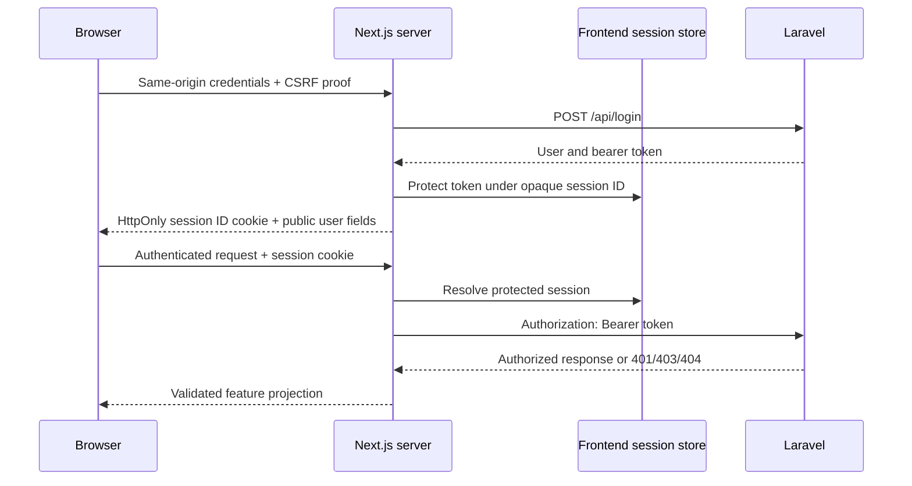

# Sanctum integration decision for a future phase

Historical Phase 1 decision. The selected BFF approach is now implemented; see
the [Phase 2 implementation report](phase-2-auth-cart.md). The assessment below
records the original rationale and is not the current feature inventory.

Status: assessment only; no authentication UI, API handlers, sessions, tokens or storage were implemented in Phase 1.

## Verified backend mode

The installed backend is explicitly bearer-token based:

- `config/sanctum.php` sets `guard` to `[]` with a comment explaining bearer-only authentication. Global expiration is 43,200 minutes.
- `bootstrap/app.php` does not enable `statefulApi()`. Configured stateful domain defaults therefore do not establish an SPA session pipeline by themselves.
- `AuthController::login` verifies credentials and returns `data: { user, token_type: "Bearer", token }`. Registration returns the same shape with HTTP 201; login returns 200. Each token is created with a 30-day expiry and `['*']` abilities.
- Login does not call a session login guard or establish a Laravel session. Logout deletes only the current access token and returns 204.
- `GET /api/user` requires `auth:sanctum`. Its resource contains `id`, `name`, `email`, `is_loyalty_member` and `created_at`; it deliberately does **not** expose `is_admin`.
- Optional Sanctum middleware on product pricing/discount endpoints can apply customer-specific eligibility when a valid bearer token is supplied. Guest pricing remains public.
- Live unauthenticated `/api/user` returned 401 with a JSON message. Live API preflight returned `Access-Control-Allow-Origin: *`, allowed the requested method/headers and did not return `Access-Control-Allow-Credentials`.
- There is no project-specific CORS config file; the inspected framework defaults allow `api/*` and `sanctum/csrf-cookie`, wildcard origins and credentials disabled. Cached/runtime settings were not changed.

Sources: backend `routes/api.php`, `AuthController`, `UserResource`, `OptionalSanctumAuthentication`, `config/sanctum.php`, `bootstrap/app.php`, framework CORS defaults and `AuthenticationTest`. No register/login/logout operation was executed to verify this assessment because those operations can change users, tokens or password hashes.

Sanctum supports separate token and SPA session modes. Laravel recommends session-based SPA authentication for first-party SPAs; switching this existing bearer-only API to that mode would require separately authorized backend work. The frontend cannot create that backend capability. See the [official Sanctum documentation](https://laravel.com/docs/12.x/sanctum#spa-authentication).

## Recommended strategy under the read-only backend constraint

Use a same-origin Next.js backend-for-frontend (BFF) with an opaque frontend session cookie. The Next.js server exchanges login/registration credentials with Laravel, receives the token, and stores it in a protected server-side session store. The browser receives only an unpredictable session identifier and a minimal user projection. It never receives the Laravel token in JSON, React props, HTML, browser storage or a raw token cookie.

Choose a durable, shared session store before Phase 2 implementation. A process-local map will not support multiple instances or reliable revocation. Do not reuse or connect directly to Laravel's MySQL database; choose an independently provisioned frontend session service with encryption/access controls and expiry. No session-store dependency has been selected or installed in this phase.

Required implementation decisions for Phase 2:

1. Use a host-only `__Host-` session cookie over production HTTPS: `Secure`, `HttpOnly`, `SameSite=Lax`, `Path=/`, no `Domain`. Use a distinct, explicitly local-development cookie convention for HTTP. Rotate the session ID after login and prevent fixation. Set idle and absolute expiry no later than the backend token lifetime; there is no refresh-token endpoint.
2. Use reviewed Next.js Route Handlers or Server Actions for a fixed set of operations. Validate inputs and response envelopes; never build an arbitrary URL/headers proxy. Access environment and token storage only on the server, via guarded modules. Validate credentials without logging them and do not forward client-supplied roles, loyalty flags, user IDs, prices, totals or arbitrary authorization headers.
3. Protect every cookie-authenticated mutation, including login and logout, against CSRF. Check the exact request `Origin` against the configured frontend origin, validate a session-bound anti-CSRF token for Route Handlers, and use Fetch Metadata as defense in depth. Any policy for non-browser clients must be explicit. `SameSite` and CORS are not substitutes. Server Actions have framework origin checks, but must still authenticate, authorize and validate every operation.
4. Fetch `/api/user` server-side when verifying the session. Clear the frontend session on upstream 401/expiry. Preserve upstream 403 and ownership-hiding 404 behavior. Do not treat a cookie's existence, a cached user projection or a client-provided user ID as proof of authorization.
5. Revoke Laravel's current token on logout, then remove the frontend session/cookie. If Laravel is unavailable, local logout should still remove browser access; document and implement the remote-revocation recovery policy rather than claiming the remote token was revoked. Do not invent an all-device logout API.
6. Mark personalized responses `no-store`. Keep per-request authentication state isolated; never cache tokens or authenticated users globally. Return only minimal feature data to Client Components.
7. Treat backend wildcard token abilities as a reason to minimize exposure: Laravel policies and middleware remain essential. Do not infer admin privileges from token abilities, email addresses or loyalty membership.
8. Add frontend abuse protection. A BFF may make Laravel see one server IP, so backend IP-based login/API rate limits can affect many users. Do not forge forwarding headers to bypass this. Coordinate trusted proxy/IP handling separately with the backend owner and rate-limit the public BFF at the frontend edge.

## Cookies, CSRF and CORS boundaries

With this design, the browser talks to Next.js on the frontend origin; Next.js talks to Laravel server-to-server using an explicit bearer token. Laravel browser CORS headers do not gate server-to-server requests. Keep the BFF private to its intended origin and do not add wildcard credentialed CORS to it.

Calling `/sanctum/csrf-cookie` and setting `credentials: include` is not an authentication solution for this backend. That endpoint, even if supplied by Sanctum, does not change the token-only login contract. Do not forward every Laravel `Set-Cookie` header to the browser. The future frontend session cookie and its CSRF defense belong to the Next.js boundary.

If the backend owner later adopts Sanctum's first-party SPA mode, reassess the session-login endpoint, `statefulApi()` middleware, session/CSRF configuration, exact credentialed CORS origins, cookie domains, HTTPS and SSR cookie forwarding as a separate design change. Never disable CSRF or authorization to make cross-origin requests work.

## Backend limitations relevant to authentication

- No refresh-token, password-reset, email-verification, profile-update or all-device logout API was found in the declared routes. Do not promise these flows.
- User responses omit admin capability. Future admin navigation needs a trustworthy capability contract or an explicitly designed server-side check against an existing authorized admin endpoint. Never fabricate an `is_admin` field or infer it client-side.
- Token lifetime is enforced server-side but an expiry timestamp is not returned in the login resource. An earlier frontend absolute session expiry plus upstream 401 handling is required.
- Authenticated mutation/E2E tests need a separately authorized testing environment and controlled users. Reading backend tests is not equivalent to executing those contracts. Phase 1 deliberately ran only read-only Laravel requests.
