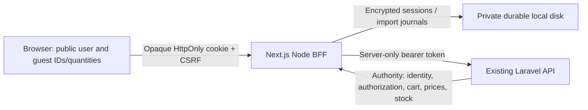

# Phase 2: authentication and cart implementation

Implementation date: 9 November 2026. Scope: customer authentication, server sessions, guest/account carts, reviewed import and lifecycle management. Checkout is a login handoff and future-phase notice only. No backend source, configuration, database, migrations or tests were changed or executed. No dependencies were added. No commits, pushes, merges, tags or releases were created.

## Implemented architecture

The existing catalog boundaries and presentation remain. Routes compose feature components; feature server adapters validate Laravel JSON; the existing shared transport now supports explicit authenticated mutations. `auth` owns credentials and identity. `cart` owns browser quantity state, account adapters and a testable merge coordinator. `lib/bff` owns opaque cookies, CSRF, encrypted persistence, locks and safe responses. Server modules import `server-only`; pure validation and merge modules accept explicit dependencies for tests.



The React commerce provider coordinates verified public identity, temporary account responses and guest quantities. It is not a second authoritative account cart. Account cart data is never written to browser storage. Navigation includes cart count and account actions; products expose real add controls. Cart components provide quantity, remove, price refresh, import review, pending progress, retry, unavailable-product and empty states. Existing visual components, keyboard controls, teal colors and responsive layout are retained.

## Verified Laravel contracts and BFF surface

The source of truth is the separate repository's `routes/api.php`, `AuthController`, `CartController`, auth/cart requests, `CartService`, `CartPricingService`, user/cart/item resources, policies, Sanctum configuration and auth/cart tests. Existing [contract inventory](backend-contracts.md) contains the broader endpoint reference. No authenticated runtime probe was sent to the protected live API: even retrieving its cart may create records.

| Browser endpoint          | Laravel calls and behavior                                                                          |
| ------------------------- | --------------------------------------------------------------------------------------------------- |
| `GET /api/session`        | `GET /api/user` when a token exists; otherwise creates an anonymous frontend session                |
| `POST /api/auth/register` | `POST /api/register`, only name/email/password/confirmation                                         |
| `POST /api/auth/login`    | `POST /api/login`, only email/password                                                              |
| `POST /api/auth/logout`   | Invalidates local record, then `POST /api/logout` to revoke current token                           |
| `GET /api/cart`           | `GET /api/cart`, authenticated owner only                                                           |
| `POST /api/cart`          | Fixed add/set/remove actions, mapped to POST `/api/cart/items`, PATCH/DELETE `/api/cart/items/{id}` |
| `POST /api/cart/quote`    | Public GET `/api/products/{id}` and `/api/products/{id}/price` for validated guest IDs              |
| `POST /api/cart/merge`    | Validated, confirmed import through individual authenticated cart calls                             |

All paths above are fixed-purpose handlers, not an arbitrary URL proxy. Existing catalog GETs remain unchanged except optional verified bearer identity for product-detail pricing. If identity cannot be verified, that detail page falls back to public pricing. Guest estimates always use public prices. Account summaries use Laravel cart pricing and eligibility.

Laravel token responses are `{data:{user, token_type:"Bearer", token}}`; the public user has no admin capability. Registration requires a mixed-case numeric password of at least 12 characters and at most 72 bytes. Frontend validation accepts Unicode lowercase/uppercase letters and numbers, matching the installed Laravel password rule. Frontend login also applies a 72-byte cap to avoid bcrypt truncation ambiguity. Email is trimmed and lowercased, while password bytes are preserved. Laravel still validates credentials, stock, quantities and ownership. No role, loyalty, price, total, user or cart ownership fields are forwarded from browser input.

Cart `POST` adds quantities; `PATCH` sets an absolute quantity. Quantities are 1–1000. Backend carts have a 100-product limit. An item's product can be null, and pricing, savings and totals can be null. The UI does not turn missing pricing into zero. Unavailable items remain removable. Product identity comes from nested `product.id`. There is no cart merge/idempotency/revision endpoint.

## Authentication and request lifecycle

1. Browser requests session discovery with same-origin credentials. The server accepts only a valid random session ID and checks its expiry. Authenticated discovery verifies `GET /user` and matches the returned user ID to the stored identity.
2. A new anonymous record has a 256-bit random ID and independent 256-bit CSRF token. The response exposes only public user fields and CSRF. It never exposes the bearer token or encrypted record.
3. Every browser POST requires exact `Origin === APP_ORIGIN`, rejects cross-site Fetch Metadata, and compares the synchronizer CSRF token in constant time. JSON bodies are limited to 32 KB and five seconds of reading. Input fields and quantity limits are validated before projection into Laravel requests.
4. Login/register succeeds only after validated Laravel authentication. The old local record is invalidated, a new random identifier and CSRF token are persisted, and a new cookie is issued. If persistence fails after token issuance, revocation is attempted before failing safely. Switching directly between authenticated identities also attempts revocation of the previous token.
5. Account/cart handlers validate the local session and verify the actual Laravel identity. Laravel policies remain the final authorization check, including ownership-hidden 404 responses. `/account` is checked on the server; the client gate also hides stale account UI after a session/account change.
6. Backend 401 invalidates the local record, clears displayed account state and requests fresh discovery. Local expiry is absolute after 12 hours, not sliding. There is no refresh-token or password-reset feature because these contracts are absent.
7. Internal return paths are limited to implemented storefront destinations. External URLs, protocol-relative paths, backslashes, controls, encoded path tricks, API paths and auth loops fall back to `/cart`.

Secure cookies use `__Host-everyday_session`, `HttpOnly`, `Secure`, `SameSite=Lax`, `Path=/`, absolute expiry and no Domain. Explicit loopback HTTP uses `everyday_session` without Secure for local testing. API responses are `no-store, private` and vary by Cookie. Server transport omits browser credentials, uses explicit Bearer injection, refuses redirects and applies an eight-second timeout. Errors expose fixed messages/codes and allowlisted validation field names, never upstream diagnostics, passwords, tokens or URLs. The implementation adds no credential logging or analytics.

The backend is bearer-only: Sanctum's SPA stateful guard is disabled. Browser traffic talks to Next.js on the same origin. Next.js talks to Laravel server-to-server, so no browser CORS permissions or `/sanctum/csrf-cookie` sequence is needed. Existing backend CORS/session settings remain untouched. The BFF has its own CSRF boundary because its browser cookie is ambient authentication.

## Persistent sessions and deployment

This implementation deliberately supports a single Node host with persistent private local disk. It uses no production in-memory session Map. AES-256-GCM encrypts session, rate-limit, import-owner and merge-journal records with random IVs and authenticated tags. Filenames are SHA-256 digests of namespace and record ID. Writes use exclusive temporary files, file sync and rename. Corruption or decryption failure fails closed with 503; it never creates a fresh merge ledger that might replay a write.

Exclusive filesystem lock files serialize session mutations and account operations across processes on the same host. An additional batch lock prevents the same frozen import being started for two different users. Contention waits up to two seconds then returns a recoverable conflict. These locks do not coordinate other hosts or clients that call Laravel directly.

| Variable                  | Requirement                                                                     |
| ------------------------- | ------------------------------------------------------------------------------- |
| `LARAVEL_API_URL`         | Server-reachable API origin and `/api`; remote production uses HTTPS            |
| `APP_ORIGIN`              | Exact browser origin, no path/query; remote production HTTPS required           |
| `SESSION_DEPLOYMENT`      | Production must explicitly be `single-host`                                     |
| `SESSION_STORE_DIRECTORY` | Production absolute private durable path outside the checkout and all web roots |
| `SESSION_ENCRYPTION_KEY`  | Production random 32-byte base64 value supplied by a secret manager             |

Production has no default session directory or key and no insecure fallback. Paths under the checkout and detected `htdocs`, `wwwroot` or `public_html` roots are rejected. Operators must also keep the directory outside any other configured HTTP alias/static root. Keep the key outside the volume in protected deployment configuration; do not commit it or paste it into logs. Back up the key and records securely together. Key replacement ends access to existing sessions and journals; no automatic rotation/migration tool is implemented.

Development uses a private project-specific directory beneath the operating-system temporary directory and a random persisted development key. It survives Node restarts while that directory exists; OS cleanup can remove it. Production must use a separately provisioned durable volume. POSIX modes request directory 0700/file 0600; **Windows deployments must enforce equivalent NTFS ACLs for the service account**, because mode bits are not sufficient. Validate those ACLs operationally.

Deploy behind TLS, configure edge request/body/concurrency limits and monitor storage/errors without recording credentials. The local email rate limiter allows five auth attempts/minute/email in addition to existing Laravel throttling. It is not a replacement for edge IP/global abuse controls. Anonymous discovery and guest quote traffic can consume disk/API capacity; production requires quotas and rate limiting. Proxying all customers through one server can also concentrate Laravel's IP-based throttling. No backend limiter configuration was changed.

Expired sessions are rejected and removed on access. Unvisited expired records, rate files and completed import journals have no automatic housekeeping yet. Define a storage/quota/retention policy before release. Do not delete journals or import-owner records while clients can still replay their snapshots; deletion removes the duplicate-prevention history. On a crashed process, stale `.lock` files deliberately remain fail-closed. Stop **all** frontend processes, establish that no request can still be in flight, then remove only verified stale locks under the dedicated private store. Never break a lock merely because it is old. File sync/rename does not claim an atomic transaction with Laravel or protection from every filesystem/power-loss failure.

Serverless/ephemeral filesystems, multiple hosts and network filesystems with uncertain lock semantics are unsupported. A shared transactional session/journal store and distributed locking would be required before changing that deployment model.

## Guest and account cart boundaries

Guest localStorage key: `everyday.guest-cart.v1`. Schema: `{version:1,items:[{productId,quantity}],pending?:{id,items}}`. Pending contains a random batch UUID and frozen contribution snapshot only. It stores no token, user profile, account quantity, pricing, product description or discount. A separate random `everyday.auth-change` marker signals revalidation to other tabs and carries no identity.

Every read validates schema, size, unique positive IDs, integer quantities and limits: 50 guest products and 1000 per product. Corrupt data is reset with a notice. When storage is unavailable, non-sensitive items stay in current-tab memory with a clear persistence warning; import is refused until progress can be persisted. Refresh/reopening can restore the cart only when storage survives. Private/shared browser storage must not be treated as an authorization boundary.

Guest estimates fetch current product and public price responses with bounded concurrency. Exact integer minor-unit multiplication/summation avoids floating-point errors; this is an explicitly labeled estimate, not discount or checkout calculation. Refresh buttons retrieve price/availability changes. Account pricing, item readiness and totals come directly from Laravel. Stock is never reserved by either cart.

Account responses live only in React memory. Busy guards prevent same-tab duplicate actions. Browser Web Locks serialize auth transitions and guest read/modify/write operations across supporting tabs. Storage events and focus trigger discovery; request epochs discard stale account responses. UI import feedback is reset when the account changes. Without Web Locks, browser coordination is best effort; server locks still serialize operations on this host. Arbitrary browser storage tampering cannot grant authorization or set prices; a deliberate new batch ID represents a new request and is not deduplicated globally by product.

## Exact import policy and recovery

Import is **always explicitly reviewed**, including first login/registration, so browser-scoped items are never assumed to belong to the newly signed-in person. The cart names the destination account, shows the existing account cart and retains guest items separately until confirmation.

1. Persist a UUID and frozen guest contribution snapshot before the first request. Guest edits are frozen while this snapshot is unresolved.
2. Under account and batch locks, bind the batch to the verified user in encrypted server storage. The same snapshot cannot be imported under a different identity. The user must finish reviewing it in the original account, or sign out and explicitly discard the remaining browser items. This avoids replaying snapshot lines that had already transferred before expiry/account switching. No account identity is added to guest storage.
3. Retrieve the latest Laravel cart. Persist a user-scoped journal containing a fingerprint, baseline quantity, intended target (`baseline + guest quantity`) and state for every contribution. Preserve account-only products.
4. Before each write, retrieve the current cart again. If quantity differs from the captured baseline, record a conflict instead of overwriting. Reject over-limit/known stock failures with an explanation.
5. Persist `intent` **before** dispatch. If the product exists, PATCH its absolute target; if absent, POST the intended quantity. Validate the returned cart's resulting quantity. Persist `confirmed` only after a matching validated response.
6. Return at most four attempted writes per request; the client continues pending work with the same batch. Remove only confirmed matching guest quantities and persist that acknowledgement. If the response or browser persistence fails, the frozen snapshot/journal lets the next review skip confirmed work.
7. Definite rejections are `failed`, leave guest data intact and permit explicit retry. When no uncertain/pending/conflict lines remain, the snapshot can be released so failed guest quantities can be adjusted or removed and a new reviewed batch created.
8. Timeout, disconnect, unexpected response, generic HTTP or server failure is `uncertain`. A surviving `intent` after interruption is also uncertain. **Never replay it automatically**, even if a later GET happens to equal the target: another device could explain that quantity.
9. The recovery UI refreshes the account cart and explains that an earlier request may still finish. The user may explicitly keep current account quantities and dismiss unresolved guest contributions. This acknowledgement sends no cart write. It requires a separate confirmation. Otherwise the items remain for review; they are never silently lost.
10. After complete confirmation, display the refreshed Laravel cart and honor the safe internal destination. Checkout intent returns to `/cart?checkout=next-phase` with the future-phase notice.

Examples: guest Laptop×1 + Mouse×2 into empty account becomes those items. Guest Laptop×1 + Keyboard×1 into account Laptop×1 + Mouse×2 becomes Laptop×2 + Mouse×2 + Keyboard×1, subject to Laravel validation. After logout, new guest Mouse×1 can be reviewed into the original account without copying any saved account items into browser storage.

Ordinary authenticated additions also use durable operation IDs/journals to prevent the same submitted additive operation from being replayed. UI never automatically retries an ambiguous add; refresh/review before deliberately submitting another addition. Absolute updates and deletions have no automatic retry and report recoverable failures.

**Limits:** This is not an atomic or exactly-once merge. Laravel provides no cart idempotency keys, bulk transaction or conditional revision writes. A direct API client/another host can change a quantity between the final GET and PATCH/POST. A timed-out request can commit after a subsequent GET. Account-wide locks coordinate this BFF host only. The implementation detects changes it can observe and stops ambiguous replay, at the cost of requiring human review. Stronger guarantees require a future backend contract change and separate authorization to implement it.

## Logout, expiry and account switching

Logout removes the local session record before remote revocation and expires the cookie. Replay of an old identifier is unauthorized. It never calls cart DELETE and never copies account lines into guest storage. Client account state is cleared immediately; after confirmed sign-out, guest state starts empty. If unimported guest contributions would be discarded, the user must confirm first. Storage events notify other tabs; focus revalidation is the fallback when broadcast storage is unavailable.

If Laravel revocation fails, local sign-out still succeeds and an explicit warning states that the upstream token may remain valid until its expiry. Laravel tokens expire after 30 days. Local expiry after 12 hours does not itself call remote logout. There is no durable remote-revocation retry queue; these residual upstream tokens and a lost logout response require operational consideration. A complete network failure to the BFF is reported as an unconfirmed action, not a claimed successful sign-out.

For A → logout → guest shopping → B, A's cart stays solely in Laravel. B sees only B's verified cart and separately reviewed guest items. An interrupted A-bound import cannot be replayed as B. Reauthentication as A can resume it. Clearing it through logout is explicit. React account data and import feedback are hidden/reset on identity changes; server authorization is required regardless of UI state.

## Security review and remaining risks

| Concern                    | Implemented control and remaining boundary                                                                                                                                                                                            |
| -------------------------- | ------------------------------------------------------------------------------------------------------------------------------------------------------------------------------------------------------------------------------------- |
| XSS/token theft            | React escapes untrusted text; no raw HTML injection, browser bearer storage or token props. HttpOnly protects token access but XSS can still act as the user. A tested deployment CSP remains required.                               |
| CSRF/login CSRF            | Exact Origin + independent synchronizer token + SameSite; cross-site metadata rejected. Reads expose no cross-origin CORS permission.                                                                                                 |
| Session fixation/hijacking | Random IDs, login rotation, old-record invalidation, expiry, host-only HTTPS cookie, encrypted records and backend identity checks. Cookie theft/server compromise remain outside these guarantees.                                   |
| Authorization/tampering    | Fixed adapters, allowlisted payloads, runtime validation and Laravel owner policies. Backend prices/discounts/stock/totals remain authoritative.                                                                                      |
| Cross-account state        | Fresh backend identity, per-account locks/journals, batch owner binding, no persisted account cart, epoch guards and tab revalidation. Previously authorized browser content cannot be retroactively erased from screenshots/history. |
| Secrets/errors             | Server-only modules and explicit token injection; safe response codes/fields, no raw exception/upstream messages, no credential logging. Windows disk ACLs and key management remain deployment duties.                               |
| Redirects                  | Implemented-route allowlist and parsed internal URL validation.                                                                                                                                                                       |
| Dependency findings        | Production audit: zero; full audit: eight moderate development lint-chain findings, rooted in minimatch glob amplification (GHSA-g3hv-75wg-m249). npm proposes downgrading `eslint-config-next` to 15.5.29; no forced fix was used.   |
| Availability/operations    | Body/time/item limits, bounded quote fan-out, auth limiter and fail-closed locks. Edge abuse controls, storage quotas/retention, stale-lock recovery, metrics and backup/restore verification are still needed.                       |

Session and CSRF choices follow the [OWASP Session Management Cheat Sheet](https://cheatsheetseries.owasp.org/cheatsheets/Session_Management_Cheat_Sheet.html) and [OWASP CSRF Prevention Cheat Sheet](https://cheatsheetseries.owasp.org/cheatsheets/Cross-Site_Request_Forgery_Prevention_Cheat_Sheet.html). This is an implemented foundation, not a claim of completed production deployment hardening.

## Validation and safe test boundary

Commands and prerequisites are in the [README](../README.md). The suite retains all 32 prior tests and adds 28 meaningful tests: 14 unit/merge/storage/security checks and 14 browser/BFF integration journeys. Total: 35 unit and 25 integration/browser checks. The browser suite uses Microsoft Edge at 320/375/768/1440 widths, verifies real catalog GETs and injects controlled response faults through a test-only relay.

Auth/cart mutations are routed **exclusively** to `tests/support/auth-api-fixture.mjs`, with synthetic accounts, random per-run credentials/tokens, faithful verified resource shapes and no database. The fixture covers owner 404s, auth expiry, validation, 403/429/503, failed revocation, partial failures and a disconnected response after an additive write actually committed. The relay only forwards public GETs to real Laravel. Tests never execute the backend's authenticated cart GET. The runner creates private per-run encrypted frontend records outside the web root and cleans only its validated owned directory after stopping its own processes.

Final validation results are recorded below. Backend integration conclusions are based on source inspection plus a contract-faithful isolated fixture; they do not replace acceptance testing against an authorized disposable Laravel environment. An initial regression run found a text locator shared by the stock badge and new disabled add button; it was scoped to the badge and extended to verify the disabled button. The subsequent complete run passed all 60 tests in 3.2 minutes. The final Unicode validation adjustment was additionally checked by the 35-test independent suite and a fresh production build.

| Check                                     | Result                                                                |
| ----------------------------------------- | --------------------------------------------------------------------- |
| ESLint                                    | Passed                                                                |
| Strict TypeScript / route type generation | Passed standalone and in production build                             |
| Prettier                                  | Passed                                                                |
| Independent unit/transport tests          | 35 passed                                                             |
| Full unit + browser/BFF suite             | 60 passed (35 unit/transport + 25 integration/browser)                |
| Production build                          | Passed; no build warnings                                             |
| Production dependency audit               | Zero vulnerabilities                                                  |
| Full dependency audit                     | Eight moderate development-tool findings; expected nonzero audit exit |

## File manifest

New implementation files:

```text
src/app/{login,register,account,cart}/page.tsx
src/app/api/session/route.ts
src/app/api/auth/[action]/route.ts
src/app/api/cart/route.ts
src/app/api/cart/{merge,quote}/route.ts
src/features/auth/{types,validation,browser-validation}.ts
src/features/auth/server/{session,session-record,actions}.ts
src/features/auth/components/{AuthForm,AccountGate,AccountActions}.tsx
src/features/cart/{types,validation,browser-validation,guest-cart,merge}.ts
src/features/cart/server/{api,quote}.ts
src/features/cart/components/{CommerceProvider,CommerceNotice,CartPage,AccountCartPanel,GuestCartPanel,EmptyCart,QuantityControl,AddToCart}.tsx
src/lib/bff/{config,file-store,runtime,security,response,browser-client}.ts
src/lib/validation.ts
tests/{auth-cart-unit,auth-cart}.spec.ts
tests/support/auth-api-fixture.mjs
docs/phase-2-auth-cart.md
```

Updated existing files:

```text
.env.example, .gitignore, README.md, playwright.config.ts
src/app/layout.tsx
src/components/layout/{Header,Footer}.tsx
src/features/catalog/api/{products,validation}.ts
src/features/catalog/components/{ProductCard,ProductDetails}.tsx
src/features/catalog/server/queries.ts
src/lib/api/{client,request,errors}.ts
src/lib/format.ts
tests/support/{api-relay,run-tests}.mjs
tests/storefront.spec.ts
docs/{architecture,authentication-strategy,backend-contracts}.md
```

Other tracked files can have Windows line-ending/stat refresh noise without content changes. Package dependencies/lockfile and backend files have no implementation changes. Screenshot/test output and private runtime files are ignored, not source artifacts.

## Required manual acceptance before release

1. In a separately authorized disposable backend environment, verify real registration/login/logout, protected user/cart resources and contract fidelity. Exercise wrong credentials, duplicate email, throttling, permission failures, token expiry/revocation and restart recovery. Do not run these mutations against the current read-only backend/database under this task's authorization.
2. On the intended HTTPS origin, inspect host-only Secure/HttpOnly/SameSite cookies, CSRF failures, origin mismatch, safe return paths, sensitive response caching and absence of bearer tokens in DOM, browser storage, RSC payloads, errors and logs. Verify TLS/HSTS/CSP and reverse-proxy behavior.
3. Verify private volume/NTFS ACLs, key secrecy, process restart, backup/restore and fail-closed behavior with unavailable/corrupt storage. Test the documented stale-lock procedure on a disposable store. Establish safe journal retention and disk/edge limits.
4. Exercise all guest/account examples, same-product quantity sums, account-only retention, partial stock/deleted/inactive products, loyalty price changes and oversized quantities. Simulate request loss after commit and inspect account quantities before explicitly dismissing uncertain contributions.
5. Test A/logout/guest/B, interrupted A import followed by B login, same-account reauthentication, multiple tabs, back/forward history, concurrent direct API changes, offline logout and failed upstream revocation. Confirm no account cart is copied to browser storage or deleted on sign-out.
6. Test keyboard/screen reader operation, actual mobile devices, storage disabled/full/corrupted, browser restart and browsers without Web Locks. Automated browser coverage is Edge, not a claim of full cross-browser accessibility certification.

## Recommended next phase

First complete the live integration acceptance and operational hardening above. Then implement the existing idempotent checkout/mock-payment and owner-scoped order flow, using Laravel's required checkout idempotency key and authoritative order/payment states. Preserve one checkout attempt key across uncertain responses. The backend has no real gateway, shipping/address/tax or payment-method contract; do not invent them. Stronger cart synchronization, refresh/password-reset/profile APIs, shared stores and admin capability discovery require separate contract/deployment decisions. Wishlist, reviews and admin UI remain later scope.
