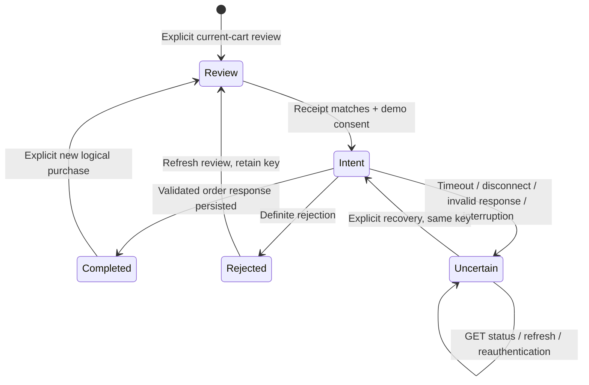

# Phase 3: checkout, mock payments and customer orders

Accepted Phase 3 baseline. Wishlist and reviews are now implemented separately in
the [Phase 4 report](phase-4-wishlist-reviews.md); the guarantees below remain in place.

Implemented on 9 November 2026, building on the manually accepted Phase 1/2 foundation. All changes are confined to `ecommerce-frontend`. Laravel files, configuration, tests and database remain unchanged. Automated checkout/payment traffic never reaches the real backend. No dependencies, commits, pushes, merges, tags or releases were introduced.

## Implemented customer experience

Guest browsing and shopping still work without authentication. Checkout intent now preserves `/checkout` through the existing login/registration and guest-import review. Untransferred guest items and frozen/uncertain imports block checkout. Signed-in customers review the current account cart, acknowledge that payment is simulated and place an order using the existing Laravel checkout transaction.

| Page                        | Implemented behavior                                                                                          |
| --------------------------- | ------------------------------------------------------------------------------------------------------------- |
| `/checkout`                 | Authenticated current-cart review, renewed review after changes, demo consent, placement and durable recovery |
| `/orders/[id]/confirmation` | Owner-verified order creation confirmation and actual payment status; refresh is read-only                    |
| `/orders`                   | Owner-scoped newest-first history, backend pagination with 10 orders/page, empty/error/retry states           |
| `/orders/[id]`              | Purchase snapshots, recorded discounts/totals, current order/payment/refund status and refresh                |
| `/orders/[id]/payment`      | Read-only mock payment/refund status and refresh                                                              |

The existing teal components, responsive navigation, cart count, forms and account actions are retained. Account and navigation links expose order history. Checkout and orders include loading, sanitized failure, retry and unexpected-error boundaries. Dates are labeled UTC. Prices remain decimal strings formatted in the backend's supported currency, MYR.

Every purchase/payment view clearly states **Demo / Simulated Payment — No Real Money Is Charged**. There are no card/banking inputs, external payment providers, shipping/address/tax forms, customer cancellation/refund actions, admin operations, wishlist or review submission.

## Verified backend contracts

Contracts were checked against `routes/api.php`, `CheckoutController`, `OrderController`, `CheckoutRequest`, `IndexOrderRequest`, `CheckoutService`, `MockPaymentService`, `OrderPolicy`, order/payment/refund models and resources, `OrderStatus`, `config/checkout.php`, and checkout/concurrency feature tests. These files were read only. Backend tests were not run, since they create database fixtures.

| Laravel endpoint, relative to `/api` | Contract used                                                                                                         |
| ------------------------------------ | --------------------------------------------------------------------------------------------------------------------- |
| `GET /cart`                          | Existing authenticated CartResource with item availability, current prices, discounts, nullable totals and readiness  |
| `POST /checkout`                     | Authenticated, empty JSON body and required `Idempotency-Key`; first success 201, replay 200, OrderResource in `data` |
| `GET /orders?page=N&per_page=10`     | Authenticated owner-only orders, descending ID, `data` plus Laravel pagination `meta`                                 |
| `GET /orders/{id}`                   | Owner policy hides another customer's order as 404; loads items and payment/refund                                    |
| `GET /orders/{id}/payment`           | Same owner policy; PaymentResource with refund, or 404                                                                |

Checkout idempotency keys are customer-scoped, case-sensitive, at most 128 characters and match `^[A-Za-z0-9][A-Za-z0-9._:-]*$`. The backend serializes the customer, returns an existing order for the same key **before** reading the current cart, locks inventory, prices products for the authenticated customer, records snapshots, deducts stock, performs mock payment and clears purchased cart lines transactionally. Client totals, prices, identity and success flags are never submitted by this frontend.

Laravel alone checks empty carts, 100-product and 1–1000 quantity limits, availability, stock, pricing and monetary overflow. It recalculates the final order under its transaction. There is no separate checkout quotation, cart revision/conditional-write or price-lock endpoint.

OrderResource fields used are `id`, `order_number`, `status`, `currency`, `subtotal`, `discount_total`, `grand_total`, `items`, `payment`, `stock_restored_at`, `created_at` and `updated_at`. Items use historical `sku_snapshot`, `product_name_snapshot`, original/discount/final unit amounts, quantity, line total and nullable discount snapshot `{id,name,type,value}`. `product_id` may be null after hard deletion. These views never fetch a current catalog price to replace a purchase snapshot.

PaymentResource includes `id`, `order_id`, `reference`, `amount`, `status`, nullable `paid_at`/`created_at`, and refund when loaded. The checkout response loads payment without necessarily loading refund; its omission is accepted. Read endpoints load refund. RefundResource supplies its ID/reference/amount, `refunded` status and timestamp.

| State                    | Confirmed backend support                                                                            |
| ------------------------ | ---------------------------------------------------------------------------------------------------- |
| Order                    | `placed`, `processing`, `shipped`, `completed`, `cancelled`                                          |
| Payment                  | `paid`, `refunded`                                                                                   |
| Mock decline             | HTTP 409; transaction rolls back, so no failed order/payment row is created and the cart is retained |
| Refund                   | Read-only display of recorded `refunded` data from the existing admin cancellation workflow          |
| Pending/separate payment | No customer operation or persisted pending state exists in the inspected implementation              |

The frontend does not invent pending payments, callbacks, pay-again buttons, customer refunds or cancellation. It displays a missing payment record as unconfirmed/unavailable, never as success. Future unsupported statuses fail response validation rather than being interpreted as paid. `X-Mock-Payment` is a local/testing-only Laravel override and is prohibited by Laravel in production. The frontend never sends this header or exposes an outcome selector; Laravel chooses the mock result. Decline UI is exercised through the isolated fixture, not by changing the real backend.

## Application boundaries and BFF

`features/checkout` owns the testable checkout state machine, cart fingerprints, runtime validation, Laravel adapter and review/consent presentation. `features/orders` owns order/payment types, resource validation, owner-scoped adapters and presentation. The existing `lib/api` transport accepts one validated idempotency header and an optional server-side error projection. Only the exact verified mock-decline message is converted into a safe `mock_payment_declined` code; other upstream diagnostics are discarded.

`CustomerBoundary` performs server identity verification for each purchase route. `AccountGate` also hides stale client content after account changes. A small shared private-query hook keys responses by verified user, CSRF session, URL and request version, ignores superseded results and supports read-only retry. Order data is fetched only through authenticated BFF handlers and is not persisted in browser storage.

| Same-origin BFF                | Purpose                                                                                                |
| ------------------------------ | ------------------------------------------------------------------------------------------------------ |
| `GET /api/checkout`            | Reads persisted attempt and latest account cart; never dispatches order placement                      |
| `POST /api/checkout`           | Allowlisted `review`, `place`, `new` and `resolveImports` commands with origin/CSRF/session validation |
| `GET /api/orders`              | Owner-authenticated history with validated page number and fixed page size                             |
| `GET /api/orders/{id}`         | Validated ID, upstream owner policy and response-identity check                                        |
| `GET /api/orders/{id}/payment` | Same protections; verifies returned `order_id` matches requested order                                 |

There are no arbitrary upstream URLs or payment mutations in this BFF. `POST /api/orders/{id}/payment` is unsupported (405). Known financial workflow failures are represented as typed attempt state, so the browser retains recovery information; malformed inputs and authentication/origin/CSRF failures retain HTTP error semantics. A Laravel checkout 401 invalidates the local session while retaining the account's attempt for reauthentication.

## Checkout review, idempotency and recovery



One active checkout checkpoint is encrypted per verified account in the existing private FileStore. It contains a random attempt UUID, a separate server-only `checkout-<UUID>` idempotency key, state, cart fingerprint, random review receipt, reviewed import markers, creation time, optional order ID and safe error code. No bearer token or checkout key is exposed in browser responses, URLs, localStorage or sessionStorage. The store is durable across Node restarts and across local-session rotation/logout; reauthentication as the same Laravel customer recovers that account's checkpoint.

1. Loading checkout only reads state. Explicit review fetches Laravel cart data and records a fingerprint of server-provided quantities, monetary fields, applied discounts, availability and stock. No authoritative amount or discount is calculated in Next.js.
2. Each review issues a new opaque receipt. Placement must match the attempt ID and receipt; a stale tab cannot accept a newer review it did not display. Browser busy guards and Web Locks reduce repeated clicks and auth-transition races; server account locks remain the shared serialization boundary with cart mutations/imports.
3. Immediately before dispatch, the BFF re-reads the Laravel cart and compares its fingerprint. Changed pricing, discounts, quantities or availability requires renewed review. Empty/unready/unpriced carts cannot initiate a new checkout.
4. A durable `intent` is persisted **before** the Laravel request. Placement sends only `{}` plus the server-held bearer and the saved idempotency key. There is no automatic financial POST retry.
5. A validated order response is persisted as `completed` before the cart is refreshed. Failure of the follow-up cart GET cannot erase a known order. The UI refreshes the actual account cart through the existing provider and navigates to read-only confirmation. It never assumes that the cart should be empty.
6. Repeated submissions of a completed attempt return its saved order ID without another checkout POST. Refreshing confirmation/history/detail/payment uses only order GETs. An explicitly requested new purchase is allowed only after known completion and must name the current completed attempt; stale submissions cannot replace a newer attempt.
7. Definite rejection records `rejected`; a mock decline is distinguished through the exact safe error projection. The user refreshes/reviews before retrying, retaining the same key. Transport/server/unexpected-response failures record `uncertain`. A surviving `intent` is exposed as uncertain on the next read.
8. Uncertain attempts cannot be replaced by a fresh key. The user can inspect history and explicitly recover with the same key. If the original order exists, Laravel returns it without consuming newly added cart items. If no order exists, this request can place the current reviewed cart. The UI states both possibilities.
9. An empty cart after uncertainty may be retried using the same key to retrieve an already-created order. A changed **nonempty** cart requires explicit fresh review before recovery can create anything. Failures during recovery remain uncertain; they do not erase the earlier unknown outcome.

There is no order lookup by idempotency key in the customer API. History is useful for human inspection, but matching amounts/dates is never treated as proof that a specific attempt completed. Reconciliation uses Laravel's actual same-key checkout replay or an already confirmed order ID. The confirmation page does not fabricate success based on query parameters or React state.

### Unresolved cart additions across devices

Guest storage remains browser-scoped. Checkout first blocks any local guest items or pending snapshot. In addition, the merge coordinator now durably registers each started cart-add/import batch under its verified account and removes that marker only after every contribution is confirmed. A failed/interrupted/uncertain batch remains recorded even after logout or on another device. Checkout checks these markers under the same account lock, so a browser with empty guest storage cannot silently bypass a known unresolved import.

Prefer completing the original import in its original cart. If that is no longer possible, checkout requires explicit current-cart review and a separate acknowledgement to keep the shown account quantities and leave earlier additions unreplayed. Both the cart fingerprint and reviewed marker list must still match before acknowledging. This clears the checkout review marker, **not** the original duplicate-prevention journal, and sends no cart mutation. Earlier remote requests may still complete; the UI states that limitation. Markers are limited to 100 per account, after which new additions fail closed until review resolves them.

This review requirement also covers uncertain ordinary account additions, since they already reuse the durable merge coordinator. Existing Phase 2 logout semantics remain: account cart stays in Laravel; guest data is never copied from it. Explicitly discarding guest browser data does not silently declare a server-side unknown write resolved.

## Guarantees and limits

- Duplicate prevention relies on the **same logical key**, Laravel's customer-scoped transaction and durable frontend checkpoint. It is not a general exactly-once claim across deleted state, independent clients/keys or infrastructure failure.
- No endpoint locks a quoted cart revision. Another direct API client, a late cart request, or price/eligibility changes can occur between the final GET and Laravel's transaction. Final Laravel order snapshots/stock checks remain authoritative. The UI identifies review values as current cart data and warns that final validation happens at placement.
- A timeout can outlive the BFF request. Recovery never substitutes a fresh key; account locks coordinate only this Node host. Explicit import acknowledgement cannot cancel an already dispatched Laravel request.
- Losing or pruning the checkpoint/key removes recovery knowledge. Production backup/restore and retention must preserve unresolved financial records. Do not silently start accepting new purchases after state loss; restore and manually reconcile first.
- New import markers cover submissions made by this implementation. Before deployment, finish any interrupted pre-Phase-3 imports in their original browser; old encrypted journals cannot be enumerated into a complete marker index automatically.
- Existing contracts expose no addresses/shipping/tax, real payment method, payment initiation, pending payment, customer refund/cancel, refresh token or idempotency-key lookup. These remain documented limitations, not invented capabilities.

## Security and deployment

The accepted bearer-only Sanctum BFF remains intact: opaque HttpOnly cookies, HTTPS host-only Secure cookies, SameSite, independent CSRF tokens, exact Origin checks, cross-site rejection, session rotation, absolute expiry and live Laravel identity/ownership verification. Safe redirects now additionally allow only implemented checkout/order routes. Price/identity/totals/simulation fields are rejected at the browser checkout boundary. Server-held tokens never enter client props, responses, DOM or browser storage.

Native upstream requests and BFF responses use no-store/private behavior; private purchase routes render dynamically and are never statically prerendered. The client discards stale query results on user/session changes, and unauthorized order IDs receive only the backend's ownership-hidden failure. Runtime parsers verify returned order/payment identities, supported status values, historical data types, nullable fields and pagination consistency. React escapes resource text; no raw HTML injection or credential logging is added.

No new environment variables are required. Continue configuring `LARAVEL_API_URL`, exact `APP_ORIGIN`, `SESSION_DEPLOYMENT=single-host`, private external durable `SESSION_STORE_DIRECTORY` and random 32-byte base64 `SESSION_ENCRYPTION_KEY`. Keep the directory outside all web roots and the checkout. Enforce service-account NTFS ACLs on Windows; POSIX mode bits are not sufficient there. The key and encrypted sessions, merge journals, import markers and checkout records must survive deployments together.

The implementation remains a single Node host with local durable disk and same-host filesystem locks. It is not horizontally scalable/serverless-ready. Invalid configuration, corrupt records and filesystem access errors fail safely; no in-memory financial fallback exists. An absent/empty volume can look like a new store: deployment mount checks must prevent accepting purchases against it after state loss. Follow the existing stop-all-processes stale-lock procedure and never remove active/uncertain records as routine cleanup. Development temporary storage can be removed by the OS and is unsuitable for production recovery. Establish quotas, protected backups, recovery drills, retention, TLS/HSTS/CSP, edge abuse controls and redacted monitoring before release. Tests passing is not a production-readiness claim.

## Verification

Run the existing scripts in the frontend only. `npm.cmd run build` must precede `npm.cmd test`. Unit tests do not need Laravel, a browser or a production build. Full browser tests require an existing populated public catalog and installed Microsoft Edge. Ports 3100/8101/8102 are reserved for owned processes.

All 60 prior tests remain, with 14 new unit/transport/workflow tests and 15 new BFF/browser tests: 49 unit plus 40 integration/browser checks, 89 total. New coverage includes stable keys/restarts, duplicate requests, input/CSRF/origin checks, rollback, changing prices/discounts, unavailable stock, real eight-second timeout, socket loss after commit, session recovery, cross-device import gating, history pagination/ownership, historical pricing, refunds, order-status refresh, read-only confirmation/payment refresh, token privacy and overflow at 320/375/768/1440 widths.

The test-only relay sends all protected commerce traffic exclusively to isolated Node fixtures. Only public catalog GETs reach real Laravel. Fixtures use synthetic per-run credentials and in-memory purchase state, while the **application under test** uses its real encrypted file store. Tests reset only their owned private frontend records for synthetic users. Checkout, payment, order, cart and user database records are never created on the real backend. The fixture is not a production payment implementation.

An initial integration run caught missing query forwarding in the test-only relay, which caused pagination tests to fail; preserving the query string fixed the fixture transport and both pagination tests. A subsequent full run found a test-driver race that signed in as another user before UI logout had completed; the test now waits for confirmed guest state. The final complete run passed all 89 tests in 3.9 minutes. No existing tests were removed or weakened. Desktop/mobile checkout and order screenshots were inspected. Existing Windows line endings were normalized by Prettier without unrelated semantic refactors.

| Check                                          | Result                                                                     |
| ---------------------------------------------- | -------------------------------------------------------------------------- |
| ESLint                                         | Passed, no warnings                                                        |
| Strict TypeScript / Next route type generation | Passed                                                                     |
| Prettier                                       | Passed                                                                     |
| Independent unit/transport suite               | 49 passed                                                                  |
| New BFF/browser integration suite              | 15 passed                                                                  |
| Complete regression suite                      | 89 passed: 49 unit/transport + 40 BFF/browser; all 60 prior tests retained |
| Production build                               | Passed, all purchase routes dynamic, no build warnings                     |
| Production dependency audit                    | Zero vulnerabilities                                                       |
| Full dependency audit                          | Eight existing moderate development lint-chain findings                    |

The full audit exits nonzero for the existing minimatch glob amplification finding (GHSA-g3hv-75wg-m249) and dependent TypeScript/ESLint packages. npm proposes downgrading `eslint-config-next` to 15.5.29; no forced fix, upgrade or dependency change was applied. These findings are in development tooling, not production dependencies.

## Required manual acceptance

1. Use a separately and explicitly authorized disposable Laravel environment to validate real login, cart/import, checkout success, decline, insufficient stock, inactive/deleted products, changed prices/loyalty eligibility, transaction rollback and same-key replay. Do not run these mutations against this task's read-only backend/database. A decline override is permitted only by Laravel local/testing configuration; the normal frontend never sends it.
2. Interrupt checkout before/after server commit, refresh, navigate away, restart Node, rotate sessions, logout/login and retry from another tab/device. Verify one logical key is retained, a new purchase cannot bypass uncertainty and new cart items survive a completed-order replay.
3. Resolve partial/uncertain imports in the original browser and exercise the separate current-cart acknowledgement from another device. Check that changed cart/marker receipts require renewed review and that no acknowledgement replays a cart addition.
4. Verify owner-only orders/payments, pagination, catalog deletion/renaming after purchase, historical pricing, admin-driven order/refund changes observed by refresh, missing payment records and backend outages. Confirmation/payment reloads must never submit another order/payment.
5. On the deployed HTTPS origin, inspect cookies, CSRF/origin rejection, safe redirects, no-store headers/CDN configuration, absence of bearer/checkout keys in browser storage/RSC/network responses/logs, logout/back-navigation behavior and cross-user isolation.
6. Validate durable volume/NTFS ACLs, secret management, restart and backup/restore, corrupt/unavailable storage, edge limits, quotas, stale-lock recovery and retention. Never delete an unknown attempt to bypass an error.
7. Test keyboard/screen-reader use, actual phones and supported browsers, disabled/full/corrupt guest storage, offline recovery and browsers without Web Locks. Automated Edge checks are not full cross-browser/accessibility certification.

## Complete file manifest

Existing files with content changes:

```text
.env.example
README.md
docs/backend-contracts.md
docs/phase-2-auth-cart.md
playwright.config.ts
src/app/account/page.tsx
src/app/cart/page.tsx
src/components/layout/Header.tsx
src/features/auth/components/AccountGate.tsx
src/features/auth/validation.ts
src/features/cart/components/AccountCartPanel.tsx
src/features/cart/components/CartPage.tsx
src/features/cart/components/GuestCartPanel.tsx
src/features/cart/merge.ts
src/lib/api/errors.ts
src/lib/api/request.ts
src/lib/bff/browser-client.ts
tests/support/api-relay.mjs
tests/support/auth-api-fixture.mjs
```

Added files:

```text
docs/phase-3-checkout-orders.md
src/app/api/checkout/route.ts
src/app/api/orders/route.ts
src/app/api/orders/[id]/route.ts
src/app/api/orders/[id]/payment/route.ts
src/app/checkout/page.tsx
src/app/checkout/loading.tsx
src/app/checkout/error.tsx
src/app/orders/page.tsx
src/app/orders/loading.tsx
src/app/orders/error.tsx
src/app/orders/not-found.tsx
src/app/orders/[id]/page.tsx
src/app/orders/[id]/confirmation/page.tsx
src/app/orders/[id]/payment/page.tsx
src/features/auth/components/CustomerBoundary.tsx
src/features/auth/use-customer-query.ts
src/features/cart/import-review.ts
src/features/checkout/types.ts
src/features/checkout/validation.ts
src/features/checkout/workflow.ts
src/features/checkout/server/api.ts
src/features/checkout/components/CheckoutActions.tsx
src/features/checkout/components/CheckoutCart.tsx
src/features/checkout/components/CheckoutExperience.tsx
src/features/orders/types.ts
src/features/orders/validation.ts
src/features/orders/server/api.ts
src/features/orders/components/OrderDetails.tsx
src/features/orders/components/OrderHistory.tsx
src/features/orders/components/PaymentDetails.tsx
src/features/orders/components/PaymentSummary.tsx
src/features/orders/components/PurchasePrimitives.tsx
tests/checkout-unit.spec.ts
tests/checkout-orders.spec.ts
tests/support/purchase-samples.ts
tests/support/purchase-api-fixture.mjs
```

Formatting-only LF normalization may also appear in Windows working-tree status; no package manifest/lockfile semantics or unrelated application logic changed. Test screenshots/results and private runtime artifacts remain ignored. Both Git repositories remain independent, with no backend diff.

## Recommended next phase

Complete disposable-environment acceptance and deployment recovery/hardening first. Then scope a supported customer feature such as wishlist, followed by reviews if desired, reusing the existing BFF and owner checks. A real payment provider, pending/asynchronous payment lifecycle, customer cancellation/refund or stronger cart/quote versioning requires separately approved backend capabilities and is not part of this delivery.
